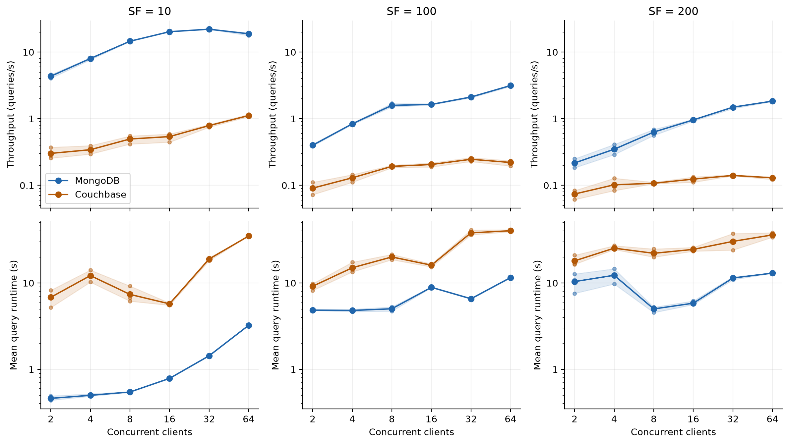
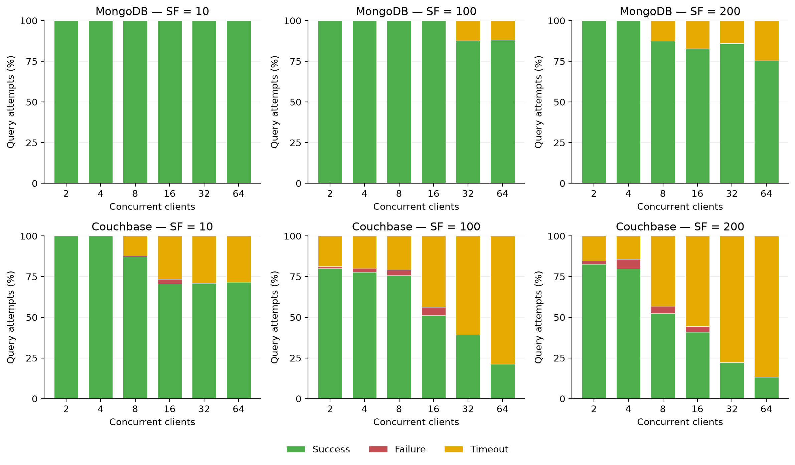

# Benchmarking JSON Document Stores for Analytical Workloads

Developed in partial fulfillment of the requirements for the degree of Bachelor of Advanced Computing (Honours) at The University of Sydney.

---

## Overview

JSONBench is a Python-based benchmark designed to evaluate the analytical performance of JSON document stores. Existing benchmarks such as TPC-H and YCSB primarily target relational databases or simple key-value workloads, providing limited support for the unique characteristics of JSON document stores.

This project addresses these limitations by providing a configurable benchmark capable of evaluating databases using realistic analytical workloads involving:

- Nested JSON documents
- Arrays and unnesting operations
- Multi-collection joins
- Aggregation queries
- Concurrent analytical workloads
- Configurable dataset sizes and workload distributions

The benchmark currently supports MongoDB and Couchbase through language-specific query generators while maintaining database-independent query templates.

---

## Features

- Extensible benchmark architecture
- Configurable data generation
- Realistic JSON document schemas
- Analytical workload simulation
- Database-independent query templates
- Automatic query generation for multiple query languages
- Concurrent workload execution
- Throughput and runtime measurement
- Reproducible benchmarking experiments
- Modular design for adding additional types of JSON document stores

---

## Benchmark Architecture

The benchmark consists of several independent modules:

- **Configuration Loader**
  - Loads benchmark parameters from the configuration file

- **Data Generator**
  - Generates realistic synthetic datasets

- **Query Generator**
  - Converts abstract query templates into database-specific query languages

- **Benchmark Driver**
  - Executes workloads using configurable concurrency

- **Database Driver**
  - Handles communication with supported databases

- **Results Logger**
  - Records benchmark execution metrics

---

## Schema

The benchmark models a realistic **tour booking platform** consisting of four collections:

- Users
- Tours
- Bookings
- Reviews

The schema intentionally incorporates embedded documents, references, nested arrays, and variable-length structures to better represent modern production applications.

---

## Workloads

The benchmark includes representative analytical queries covering:

- Revenue analysis
- Traveller demographics
- Group size analysis
- Destination popularity
- Review aggregation
- Age distributions
- Multi-collection joins
- Nested array processing

These workloads exercise various operations such as aggregation, filtering, grouping, joins, and array unnesting.

---

## Configuration and installation

Use Python 3.11 and run commands from the repository root. Install the frozen
experiment dependencies and test tools in a virtual environment:

```sh
uv venv --python 3.11
uv pip install -r requirements-lock.txt
uv pip install pytest ruff
source .venv/bin/activate
```

Single-run settings live in `jsonbench/src/config.json`. Set `database` to
`mongodb` or `couchbase`, and configure `scale_factor`, `workers`, `duration`
(measurement seconds), `warmup_seconds`, `query_timeout_seconds`, `seed`,
`reference_date`, `dataset_directory` and query-selection probabilities.
The eight database-independent templates are in `jsonbench/src/queries.json`.

Add a `connection` object with the appropriate fields:

- MongoDB: `uri` and `database`.
- Couchbase: `uri`, `username`, `password`, `bucket` and `scope`.

Use dedicated benchmark destinations. Keep credentials out of committed
configuration files. The matrix runner supports a password environment variable,
as shown in `experiments/connections.example.json`.

## Generate, insert and verify data

Generate the canonical dataset offline using the configured scale, seed and fixed
reference date:

```sh
python -m jsonbench -d
```

Generation writes JSONL collections and a manifest with checksums and counts. It
refuses to overwrite an existing dataset directory. Generate once and use the same
artifact for both databases.

Start the selected database, configure its connection, and set
`replace_collections: true` before loading:

```sh
python -m jsonbench --load
python -m jsonbench --verify
```

Loading replaces the four benchmark collections. It validates the dataset before
connecting and requires either an empty destination or an existing JSONBench
ownership marker. A nonempty, unmarked destination is refused. For Couchbase,
create the bucket and an empty dedicated scope first. The loader creates the
collections and configured indexes. Repeat loading and verification with the other
backend and the same `dataset_directory`.

Verification compares every loaded document against the canonical artifact and
rejects missing, extra, duplicate or changed documents. It also reports Q4's fixed
location selectivity, including zero matches. Keep data immutable during runs.
Verification uses temporary disk space and warms database caches.

Run one configured workload with:

```sh
python -m jsonbench
```

With `dataset_directory` configured, each run verifies loaded content before
measurement. For large datasets, increase `startup_timeout_seconds` to accommodate
this scan (the paper matrix uses 3600 seconds).

## Run the experiment matrix

`experiments/paper-matrix.json` defines **108 runs**: two databases, scale factors
10/100/200, client counts 2/4/8/16/32/64, and three repetitions. Each run has a
60-second warm-up, 180-second measurement window and 60-second query timeout.
The matrix adds a 60-second cooldown between runs. Dataset seed 42 is fixed;
workload seeds are 42, 43 and 44. Client order is reversed in repetition two.

In the commands below, `my-matrix` is an example name for your experiment's
output directory. Replace it with a name of your choice, such as
`paper-memory24`. Use the same output path for preparation, both database phases
and subsequent resumes of that experiment; choose a new directory for a separate
experiment.

Preview the plan and generate its datasets without database access:

```sh
python -m jsonbench.matrix plan --output analysis/my-matrix
python -m jsonbench.matrix prepare --output analysis/my-matrix
```

Commit tracked changes before executing the matrix: the runner requires a clean
tracked working tree. Configure `experiments/connections.example.json` or supply
another file with `--connections`. Set `JSONBENCH_CB_PASSWORD` in your environment
without committing its value. Start MongoDB with Couchbase stopped, then run:

```sh
python -m jsonbench.matrix run --backend mongodb \
  --output analysis/my-matrix --connections experiments/connections.example.json
```

After that phase completes, stop MongoDB and start Couchbase, then run:

```sh
python -m jsonbench.matrix run --backend couchbase \
  --output analysis/my-matrix --connections experiments/connections.example.json
```

The runner loads the dataset for each scale and verifies it before each workload.
It records the plan, dataset fingerprints, source revision, queries, index metadata
and per-attempt events. Repeating a command resumes pending cells and retains
completed cells. Inspect failed attempts before explicitly adding `--retry-failed`;
previous attempts are preserved. Use a new output directory for a changed protocol
or source revision. A completed cell can contain query errors and timeouts.

The generic matrix runner assumes databases are already provisioned and manages
neither service memory limits nor installation. `jsonbench.native_matrix` is an
optional Linux/systemd wrapper that runs MongoDB and Couchbase sequentially and
collects resource samples. It requires installed services, credentials, sudo access
and `infra/native-service.sh` installed at
`/usr/local/sbin/jsonbench-native-service`. See its `--help` for configuration.
Use a dedicated host for performance measurements and record its database resource
limits; local correctness checks are not equivalent to EC2 performance results.

## Performance metrics and artifacts

- **Throughput:** successful query completions within the measurement window divided
  by its duration. This includes warm-up admissions that finish during measurement.
- **Mean runtime:** elapsed execution time, including full result consumption,
  averaged over successful queries started during measurement. Their completions
  during the subsequent drain period are included.
- **Outcomes:** success, timeout and error counts for measurement-admitted queries,
  including drained completions. Errors and timeouts contribute neither to the
  throughput numerator nor to the successful-runtime average.

Workers share timing boundaries and stop admitting queries when measurement ends.
Startup/drain watchdogs bound the benchmark process and preserve partial events if
it aborts. Each run writes `info.json`, incremental `events.jsonl`, and a
`summary.json` on normal completion. Failed queries retain their error details.

Runtime averages are subject to survivorship bias: expensive queries disappearing
into timeouts can make the average fall while the workload becomes less successful.
Inspect per-query outcomes alongside runtimes. Some Couchbase internal deadline
errors arrive as generic SDK exceptions and are recorded as errors rather than
explicit timeouts. The combined failure rate includes both categories.

## Evaluation and figures

The following figures show the larger-host 24 GiB service-budget evaluation.
MongoDB used a 12 GiB WiredTiger cache; Couchbase used an 8 GiB data quota and
4 GiB index quota. Both databases ran sequentially on the same 16-vCPU / 32 GiB
host. These results illustrate how the benchmark exposes scaling limits and
unsuccessful queries under this workload and configuration.



Lines average three repetitions; shading spans their minimum and maximum.
Throughput and runtime use the cohorts defined above.



Each bar shows the mean of the three repetition-level outcome percentages.
“Failure” in this stacked chart denotes recorded errors; timeouts are separate.

`notebooks/result_analysis.ipynb` produces the evaluation figures and tables.
Set `MATRIX_NAME = "my-matrix"` in its first code cell to the experiment name
chosen for `--output analysis/<name>`, then run all cells. The notebook reads
`analysis/<name>` and exports PNG and PDF figures to `analysis/<name>/figures`.
It expects a completed 108-cell paper matrix.
Raw results, generated figures and diagnostic logs under `analysis/` are ignored
by Git; the selected publication figures above are intentionally kept in `img/`.
Supply the corresponding run artifacts before executing the notebook.


## Technologies

- Python
- MongoDB and MongoDB Query Language (MQL)
- Couchbase and SQL++
- Faker
- pandas and Matplotlib
